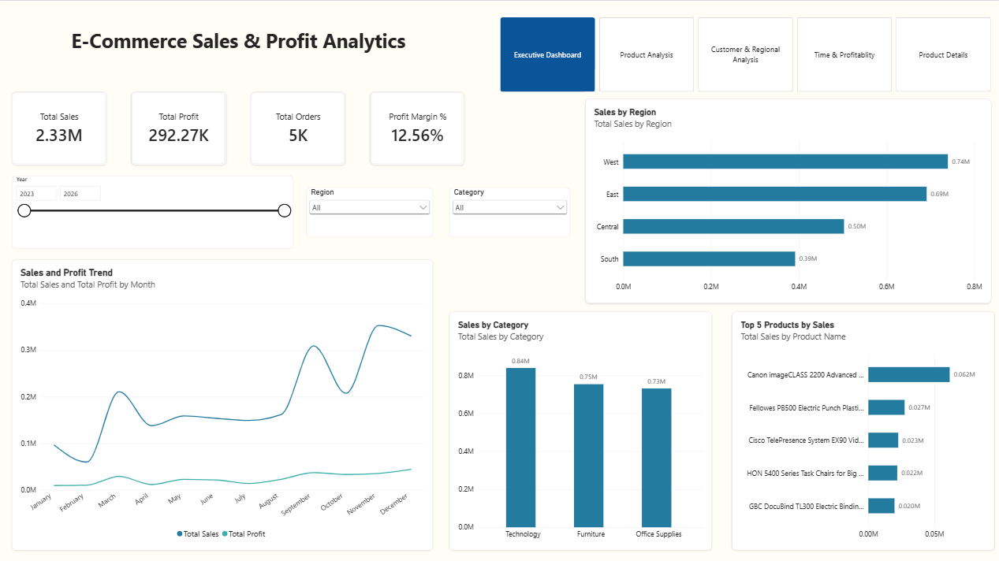
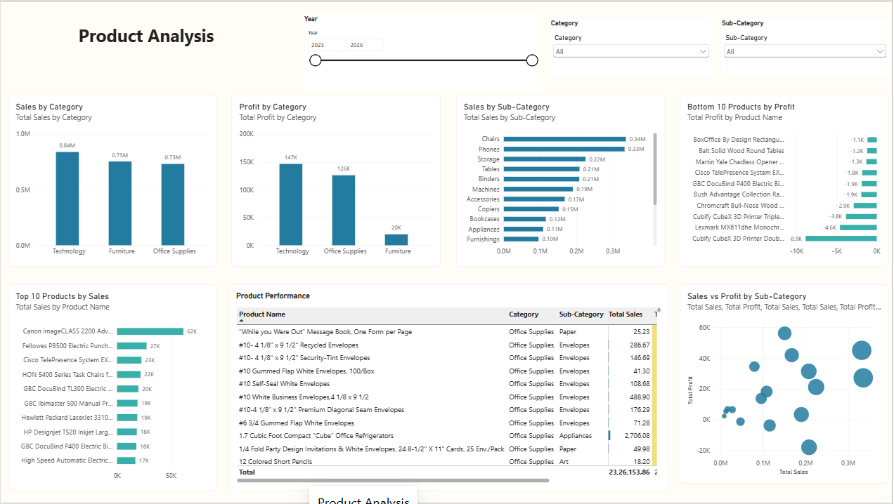
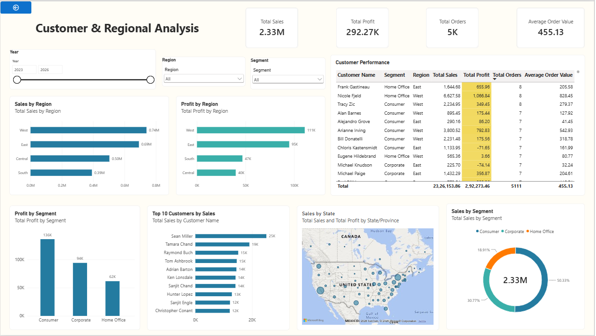
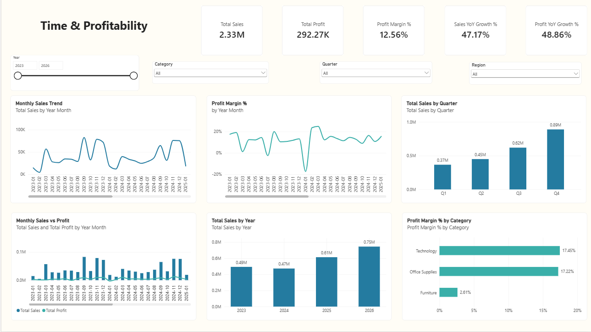
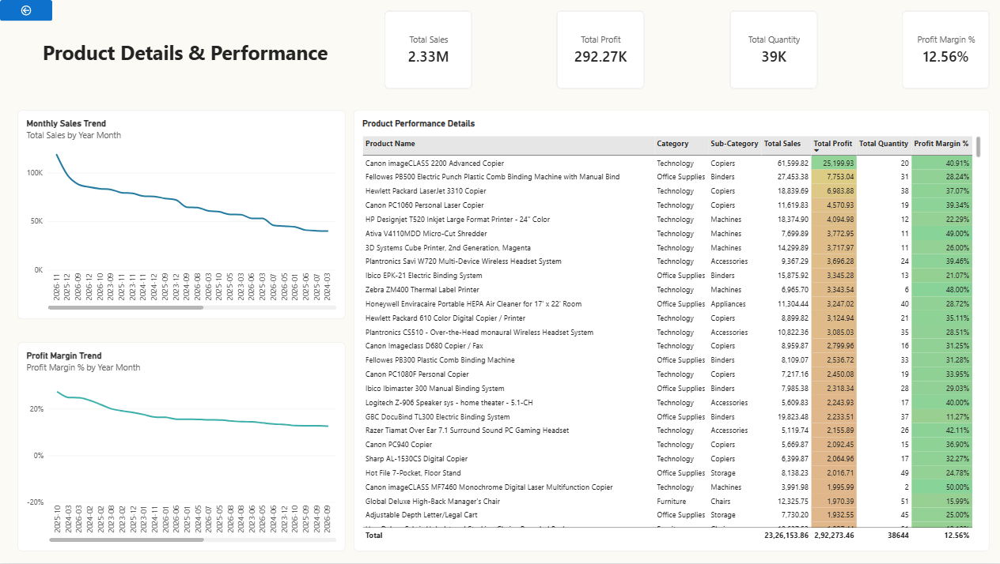

### **E-Commerce Sales \& Profit Analytics Dashboard**

###### **Project Overview**
An interactive Power BI dashboard built to analyze e-commerce sales, profit, product performance, customer behavior, and regional trends using the Sample Superstore dataset.

###### **Tools \& Technologies**
* Microsoft Power BI
* Power Query for data cleaning and transformation
* DAX for measures and time-based calculations
* Microsoft Excel as the data source

###### **Dashboard Pages**

1\. Executive Dashboard
* Total Sales, Total Profit, Total Orders, and Profit Margin
* Sales and profit trends
* Sales by category and region
* Top 5 products by sales

2\. Product Analysis
* Sales and profit by category and sub-category
* Top 10 and bottom 10 products
* Product performance table
* Sales versus profit analysis

3\. Customer \& Regional Analysis
* Sales and profit by region
* Customer performance
* Top 10 customers
* Sales by state and segment

4\. Time \& Profitability
* Monthly sales and profit trends
* Yearly and quarterly sales comparisons
* Profit margin analysis
* Year-over-year growth measures

5\. Product Details
* Product-level sales, profit, and quantity
* Monthly sales and profit trends
* Conditional formatting for profitability
* Drill-through functionality for individual products

###### 

###### **Key Performance Indicators**
* Total Sales
* Total Profit
* Total Orders
* Total Quantity
* Average Order Value
* Profit Margin
* Sales and Profit Year-over-Year Growth

###### **Data Preparation \& Modeling**
* Cleaned and checked the source data using Power Query.
* Applied appropriate data types to columns.
* Created a dedicated DateTable.
* Established a relationship between the date table and order dates.
* Created DAX measures for business performance analysis.

###### **Interactive Features**
* Year, category, region, segment, and quarter slicers
* Report page navigation
* Product-level drill-through
* Custom product tooltip
* Conditional formatting in product tables

###### **Project Structure**
* "Dataset/" — Source Excel dataset
* "PowerBI/" — Power BI report file
* "Screenshots/" — Dashboard screenshots
* "Documentation/" — Supporting project documentation
* "README/" — Project documentation

###### **Purpose**
This project demonstrates practical skills in data cleaning, data modeling, DAX, interactive reporting, and business intelligence using Power BI.

###### **Dashboard Preview**
1\. Executive Dashboard

2\. Product Analysis

3\. Customer \& Regional Analysis

4\. Time \& Profitability

5\. Product Details

###### **Note**
This project uses sample Superstore data for educational and portfolio purposes.

